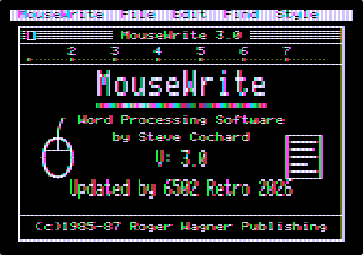
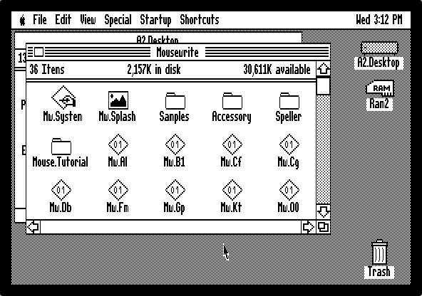
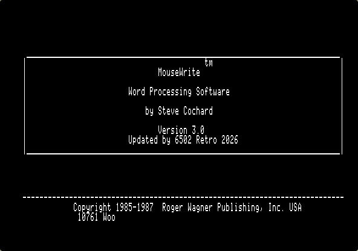
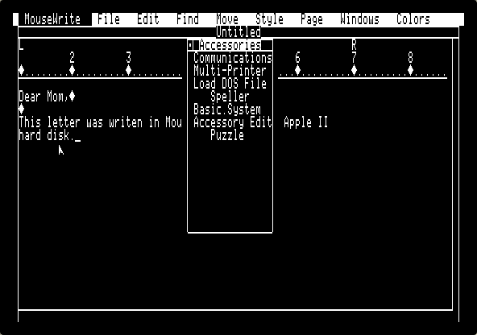
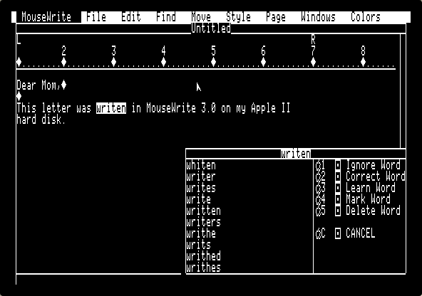

# MouseWrite 3.0

**An unofficial 2026 update of _MouseWrite_ (Steve Cochard / Roger Wagner Publishing, 1985–87) for the Apple IIe / IIc / IIgs. It runs from a hard-disk folder with all its accessories, speller and fonts, and has a new title screen.**



MouseWrite is Steve Cochard's mouse-driven, MouseText word processor for 128K Apple II computers. Version 2.6.8b came as a set of floppies (program, desk accessories, speller), with every folder location hard-wired to the floppy names `/MOUSEWRITE/…`. This project turns it into **version 3.0**, which lives happily in a folder on a modern Apple II setup: a hard disk, a CFFA/BOSS/MicroDrive card, Apple II DeskTop, or an emulator.

This repository contains **only new work**: 6502 source, the build script, tools and documentation. It does not contain MouseWrite itself. You build 3.0 from your own copy of the original disks (see [Building](#building)).

---

## What's new

| | |
|---|---|
| **Runs from any folder on a hard disk** | Desk Accessories, the Speller and the Open/Save default folder work from a hard-disk folder. At every start MW.SYSTEM checks the three folder paths MouseWrite keeps in its preference files. Any path that can't be found is pointed at the `SAMPLES`, `ACCESSORY` or `SPELLER` folder next to MW.SYSTEM. You can copy or move the folder anywhere, at any depth. Paths you set yourself in *Startup Preferences* are kept. |
| **New title screen** | A double hi-res splash (`MW.SPLASH`) in the style of [Mouse Calc 2.0](https://github.com/Adarjo6502/MouseCalc-2.0-for-Apple-)'s, showing *V: 3.0* and *Updated by 6502 Retro 2026*. It shows for about 3 seconds, and any key skips it. |
| **Version 3.0 identity** | The loading screen, the *Expanded Desktop* banner and *About MouseWrite* say *Version 3.0*. The loading screen adds *Updated by 6502 Retro 2026*. |
| **Mouse tutorial** | *A Guided Tour of the Mouse* no longer asks for the `/MOUSEWRITE` floppy. Both of its choices work from any folder. |
| **Custom fonts** | The `CF.GLOSS` glossary inserts the installed `ACCESSORY/FONTS/…` paths. |
| **Personal dictionary** | If you supply the 5.25" SPELLER disk, its custom words are merged into the 2.6.8b dictionary. |
| **Everything in one folder** | Program, accessories (Communications, Multi-Printer, Load DOS File, Speller, Basic.System, Accessory Edit, Puzzle), fonts for Apple, Epson and C.Itoh printers, samples, the tutorial, the Art Pack disks and, optionally, MouseWrite 1.5.7 in its own folder. |

<table><tr>
<td></td>
<td></td>
</tr><tr>
<td></td>
<td></td>
</tr></table>

More detail: [Hard disk & DeskTop](docs/HARD_DISK.md) · [How it works](docs/INTERNALS.md) · [Changelog](docs/CHANGELOG.md)

---

## Getting 3.0

MouseWrite itself is still copyrighted, so this project can't hand out finished disks. Instead it turns **your own copy** of the original disks into 3.0 in one step. Download this repository (green **Code → Download ZIP** button), add your disk images, and run one command.

## Building

You need:

* your own image of the **MouseWrite 2.6.8b 800K disk** (`.2mg` or `.po`, volume `/MOUSEWRITE`). This one is required.
* optional, picked up automatically if present: the 5.25" **SPELLER** disk (personal-dictionary words), the **Art Pack** disks, and the **MouseWrite 1.5.7** disk;
* **Python 3.8+**, and nothing else;
* optional: **cc65** (`ca65`/`ld65`) to re-assemble the 6502 code yourself. Without it the build uses the ready-assembled copy in [`prebuilt/`](prebuilt/).

```sh
git clone https://github.com/Adarjo6502/MouseWrite.git
cd MouseWrite
cp /path/to/"MouseWrite V2.6.8b.2mg" /path/to/other/disks/* originals/
python3 build.py
# or, to install straight into a copy of your Apple II DeskTop hard disk:
python3 build.py --install-into /path/to/A2DeskTop.hdv
```

`build.py` identifies each disk by content, not by file name. It checks the SHA-1 of every file it changes, so it refuses to run on a different release. Output, in `out/`:

| File | What it is |
|---|---|
| `MouseWrite_3.0_Folder.hdv` | 2 MB ProDOS disk `/MWINSTALL` holding the `MOUSEWRITE` folder (and `MW.V1.5.7`). Mount it as a second drive and drag the folder onto your hard disk. |
| `files/` | the 7 new or changed files, for updating an existing install by hand |
| `<your disk>.hdv` | with `--install-into`: a copy of your hard-disk image with `/<VOLUME>/MOUSEWRITE` (and `MW.V1.5.7`) added. The image you name is left untouched. Use `--folder` for another folder name or path. |

## Installing on your own hard disk

Copy the `MOUSEWRITE` folder anywhere on your drive (Apple II DeskTop or CiderPress II will do it), open it and double-click **MW.SYSTEM**. On the first start from its new home it points its folder paths at the new location. Keep `SAMPLES`, `ACCESSORY` and `SPELLER` inside the `MOUSEWRITE` folder. Details, tips and troubleshooting are in [docs/HARD_DISK.md](docs/HARD_DISK.md).

To upgrade an existing 2.6.8b folder, copy `MW.SYSTEM`, `MW.UI` and the new `MW.SPLASH` from `out/files/` over the old ones. The other files in `out/files/` are optional.

## Requirements

These are the same as for the original MouseWrite: a 128K enhanced Apple IIe, IIc or IIgs with a mouse. The new code uses only original 6502 instructions.

Tested in the [apple2js](https://github.com/whscullin/apple2js) emulator (enhanced IIe, Apple II DeskTop 1.5, ProDOS 2.4). The tests covered launching from a DeskTop folder, all desk accessories, the Speller, Basic.System and `BYE`, Open/Save, glossaries, custom-font printing, Quit, the tutorial, MouseWrite 1.5.7, and a folder moved with stale paths.

## Repository layout

```
build.py            one-step build from your original disks
src/                6502 assembly (ca65): the MW.SYSTEM add-on (path fixer + splash)
prebuilt/           the add-on assembled, and the MW.SPLASH picture
tools/              ProDOS reader/writer + fsck, Applesoft tokenizer, splash generator, 6502 helpers
test/               apple2js patch and Playwright harness used for testing
docs/               documentation and screenshots
originals/          put your original disk images here (ignored by git)
```

## Credits and legal

*MouseWrite* © 1985–1987 Steve Cochard and Roger Wagner Publishing, Inc. The speller dictionary is © 1985, 1986 Software Heaven Inc. This is an unofficial fan update. It is not affiliated with or endorsed by the original authors or publishers. No original program code, text or disk images are distributed here; the build reads them from disks you provide.

The new code, tools and documentation in this repository are © 2026 6502 Retro and released under the [MIT License](LICENSE).

Thanks to the [apple2js](https://github.com/whscullin/apple2js) and [cc65](https://cc65.github.io/) projects, and to the [Apple II DeskTop](https://github.com/a2stuff/a2d) project.
